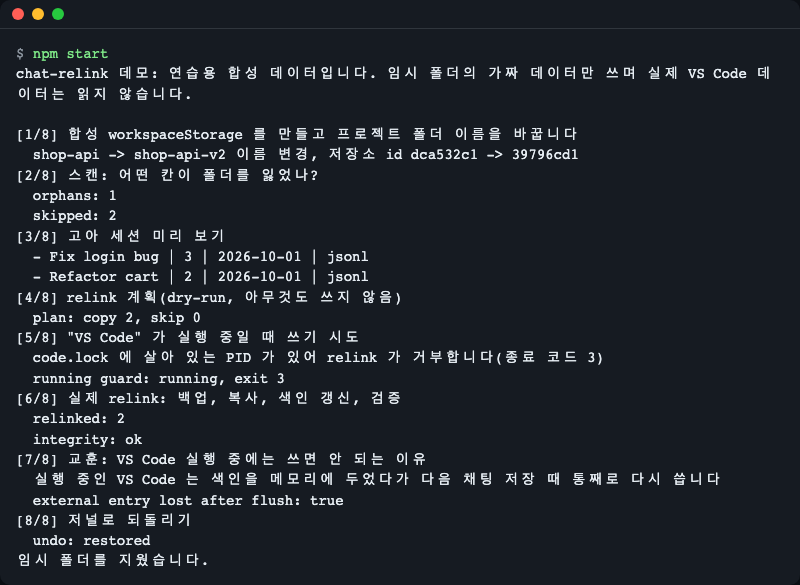
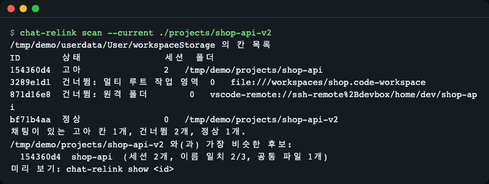
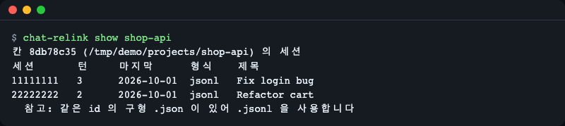
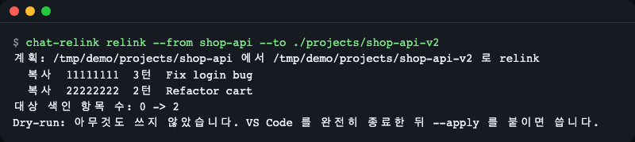
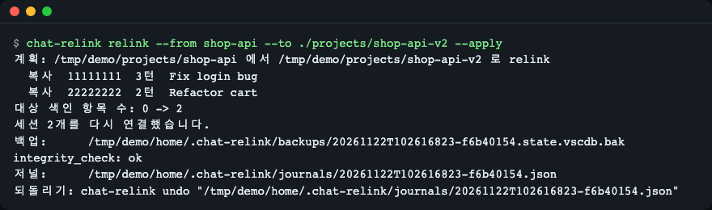
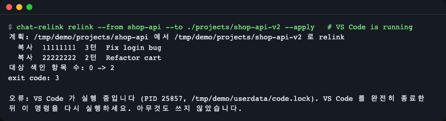
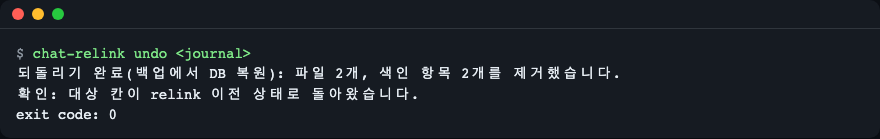
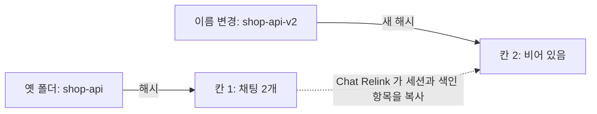

# Chat Relink

[English](README.md) | **한국어**

Chat Relink 는 프로젝트 폴더 이름을 바꾸거나 옮기거나 다시 클론한 뒤 화면에서 사라진 VS Code 채팅 세션을 찾아 미리 보여 주고, 백업·검증·되돌리기와 함께 새 폴더에 다시 연결해 주는 도구입니다. 읽기 전용 VS Code 확장과 Node CLI 로 이루어져 있고, 둘은 런타임 의존성이 없는 TypeScript 코어 하나를 같이 씁니다.


*`npm start` 는 합성 연습용 데이터로 전체 흐름을 실행합니다. 내 VS Code 데이터는 읽지 않습니다.*

> **솔직한 현재 상태 (v0.1.3).** 테스트는 모두 합성 데이터와 `vscode` API 목(mock)으로 돌렸습니다. 확장은 **실제 VS Code 안에서 실행해 보지 못했고**, CLI 도 macOS 에서만 실행했습니다. 소중한 데이터에 쓰기 전에 [지원 레이아웃과 한계](#지원-레이아웃과-한계)를 읽어 주세요. CLI 는 `--apply` 없이는 아무것도 바꾸지 않고, 바꾸기 전에 항상 백업합니다.

## 무엇을 해 주나요

- **고아 채팅을 찾습니다.** `workspaceStorage/<id>/workspace.json` 을 읽어 폴더가 더는 없는 칸(slot)을 알려 줍니다.
- **미리 보여 줍니다.** 옮기기 전에 세션별 제목·턴 수·마지막 날짜·파일 형식을 보여 줍니다.
- **안전하게 다시 연결합니다(CLI).** 기본은 dry-run(계획만 출력)입니다. `--apply` 를 붙이면 상태 DB 를 백업하고, 세션 파일을 덮어쓰지 않고 복사하고, 색인 항목을 한 트랜잭션으로 추가하고, 결과를 검증하고, 실패하면 되돌립니다. `undo` 로 원상 복구합니다.
- **VS Code 안에서 엽니다(확장).** 알림이 고아 채팅을 알려 주면 QuickPick 에서 세션을 골라 공식 `Chat: Import Chat...` 명령으로 엽니다. VS Code 저장소에는 절대 쓰지 않습니다.

우편물 전달 서비스를 떠올리면 쉽습니다. 이사했는데 우체국은 아직 옛 우편함 번호로 배달합니다. 편지(채팅)는 사라진 것이 아니라 옛 주소에 있습니다. Chat Relink 는 옛 주소의 편지를 찾아 새 주소로 전달해 줍니다.

## 요구 사항

| 항목 | 확인한 버전 | 비고 |
|---|---|---|
| Node.js | 26.13.0 (`>=22.13` 필요) | CLI 는 내장 `node:sqlite` 를 쓰므로 따로 설치할 것이 없습니다 |
| npm | 11.20.0 | |
| OS | macOS (CLI 실행) | Windows·Linux 의 id 규칙은 고정값 단위 테스트만 했습니다 |
| VS Code | 실행해 보지 못함 | `engines.vscode` 는 `^1.146.0`, 확장은 목으로만 테스트했습니다 |

Node.js 는 패키지 관리자로 설치하세요. macOS 는 `brew install node`, Debian/Ubuntu 는 `sudo apt-get install nodejs npm` 입니다(`node --version` 이 22.13 이상인지 확인).

## 설치

```bash
git clone https://github.com/LeeGyeongPil/chat-relink.git
cd chat-relink
npm ci
npm run build
```

아래에서 `chat-relink` 는 `node dist/cli/index.js` 를 뜻합니다. 진짜 `chat-relink` 명령이 필요하면 `npm link` 를 한 번 실행하세요.

확장을 써 보려면 VSIX 를 만들어 설치합니다(패키징은 했지만 실제 VS Code 에 설치해 보지는 **못했습니다**).

```bash
npm run package   # 릴리스 단계: npx 로 @vscode/vsce@4.1.1 을 받으므로 네트워크 필요
code --install-extension chat-relink-0.1.3.vsix
```

## 빠르게 시작하기

연습 데모를 실행합니다. 임시 폴더에 합성 `workspaceStorage` 를 만들고 프로젝트 이름을 바꾼 뒤, 실제 파일과 실제 SQLite DB 로 모든 단계를 거칩니다. 내 데이터는 건드리지 않습니다.

```bash
npm start
```

마지막 줄들은 이렇게 보입니다(영어 출력, 실제 실행 결과):

```text
[6/8] Relink for real: backup, copy, update index, verify
  relinked: 2
  integrity: ok
[7/8] The lesson: why we never write while VS Code runs
  a running VS Code caches the index and rewrites all of it on the next chat save
  external entry lost after flush: true
[8/8] Undo with the journal
  undo: restored
```

그다음 내 데이터에 써 봅니다. 영구 연결 단계에서는 VS Code 를 **종료**해야 합니다.

```bash
chat-relink scan --current ~/code/shop-api-v2
chat-relink show shop-api
chat-relink relink --from shop-api --to ~/code/shop-api-v2          # dry-run
chat-relink relink --from shop-api --to ~/code/shop-api-v2 --apply  # 실제로 씀
```

## 사용법

스크린샷은 데모의 합성 데이터입니다. 폴더 `shop-api` 를 `shop-api-v2` 로 바꾼 상황입니다.

### 1. 고아 찾기: `scan`


*한 줄이 `workspaceStorage` 칸 하나입니다. `고아` 는 폴더가 없어졌는데 채팅이 남은 칸입니다. 원격·멀티 루트 작업 영역은 이유와 함께 건너뜁니다.*

`--current <폴더>` 를 주면 그 폴더와 얼마나 비슷한지(이름 일치, 두 폴더에 같이 있는 파일)로 고아 칸의 순위를 매깁니다.

### 2. 미리보기: `show`


*복사하기 전에 제목·턴 수·날짜를 확인합니다. `.jsonl` 과 같은 id 의 구형 `.json` 이 있으면 알려 주고 `.jsonl` 을 씁니다.*

### 3. 계획: `--apply` 없는 `relink`


*dry-run 은 무엇을 복사하고 대상 색인 항목이 몇 개가 되는지 보여 줄 뿐 아무것도 쓰지 않습니다.*

### 4. 적용: `relink --apply`


*백업(`VACUUM INTO`)과 저널을 먼저 씁니다. 복사와 색인 갱신 뒤 `PRAGMA integrity_check` 를 돌리고, 색인을 다시 파싱하고, 파일이 있는지 확인합니다. 하나라도 실패하면 전부 되돌립니다(종료 코드 4).*

### 5. VS Code 실행 중에는 쓰지 않음


*`code.lock` 에 살아 있는 프로세스 id 가 있으면 CLI 는 종료 코드 3 으로 멈추고 아무것도 쓰지 않습니다.*

### 6. 되돌리기: `undo <저널>`


*저널 경로는 `--apply` 가 출력합니다. 되돌리기는 DB 를 복원하고, 그 사이 VS Code 가 새 채팅을 저장했다면 자기가 추가한 항목만 제거합니다.*

### VS Code 안에서

확장은 시작할 때 백그라운드로 `workspaceStorage` 를 훑습니다. 연 폴더에 채팅이 없는데 비슷한 고아 폴더에 있으면 **Review**·**Not now**·**Never for this folder** 가 있는 알림을 띄웁니다. 명령 팔레트에서 **Chat Relink: Find Orphaned Chats**(고아 채팅 찾기)를 직접 실행해도 됩니다.

- QuickPick 에서 세션(제목·턴 수·마지막 날짜)을 고르면 `workbench.action.chat.import` 로 하나씩 열립니다. 이것은 **가져온 사본**입니다. VS Code 의 import 는 원래 세션 id 와 날짜를 버리므로 사본은 새 id·날짜를 받을 수 있습니다.
- **Relink permanently...** 는 계획 파일을 쓰고 CLI 명령을 클립보드에 복사합니다. VS Code 를 완전히 종료한 뒤 터미널에 붙여 넣으세요. 원래 세션 id·제목·날짜가 유지되는 것은 이 경로뿐입니다.
- 복사된 명령은 `npx chat-relink relink ...` 로 시작하므로 `npx` 가 npm 에 게시된 `chat-relink` 패키지를 한 번 내려받아 실행합니다(네트워크 요청 1회, 클론한 코드가 아니라 게시된 버전). 클론해서 빌드했다면 `npx chat-relink` 대신 `node dist/cli/index.js` 로 바꿔 붙여 넣으세요. 패키지가 아직 npm 에 없으면 `npx` 가 404 로 실패하니 `node dist/cli/index.js` 형태를 쓰세요.

실제 VS Code 가 없는 환경이라 확장 스크린샷은 찍지 못했습니다. 그래서 여기에는 없습니다.

### 그 밖의 명령

| 명령 | 하는 일 |
|---|---|
| `chat-relink export --from <칸\|경로> --out <폴더>` | 공식 `Chat: Import Chat...` 용으로 세션마다 JSON 하나를 씁니다. 채팅에 붙여 넣은 비밀 값이 들어 있을 수 있으니 채팅 자체처럼 다루세요. |
| `chat-relink demo [--keep]` | 연습 데모. `--keep` 은 합성 폴더를 남겨 다른 명령을 시험해 볼 수 있게 합니다. |
| `chat-relink --version` / `--help` | `0.1.3` / 사용법을 출력합니다. |

종료 코드: 0 성공, 1 실패, 2 사용법 오류, 3 VS Code 실행 중, 4 검증 실패(되돌림), 5 대상 칸 없음.

공통 옵션: `--user-data-dir <폴더>`, `--product code|insiders|vscodium|cursor`, `--json`, `--lang en|ko`.

## 설정

| 키 | 기본값 | 설명 |
|---|---|---|
| `chatRelink.language` | `auto` | 확장 언어: `auto`(VS Code 표시 언어), `en`, `ko` |
| `chatRelink.scanOnStartup` | `true` | 폴더를 열 때 고아 채팅을 찾습니다 |
| `CHAT_RELINK_LANG` (환경 변수) | 없음 | CLI 언어 `en` 또는 `ko`. 우선순위: `--lang` > `CHAT_RELINK_LANG` > `LC_ALL`/`LC_MESSAGES`/`LANG`(`ko` 로 시작하면 한국어) > 영어 |
| `CHAT_RELINK_USER_DATA_DIR` (환경 변수) | 없음 | `--user-data-dir` 을 안 줬을 때 쓸 사용자 데이터 폴더 |
| `CHAT_RELINK_HOME` (환경 변수) | `~/.chat-relink` | 백업·저널·계획 파일을 쓰는 폴더 |

기본 사용자 데이터 폴더: `~/Library/Application Support/Code`(macOS), `%APPDATA%\Code`(Windows), `~/.config/Code`(Linux). `Code - Insiders`·`VSCodium`·`Cursor` 는 `--product` 로 고릅니다. 백업과 저널은 `~/.chat-relink/backups`, `~/.chat-relink/journals` 에 저장됩니다(기준 폴더는 `CHAT_RELINK_HOME` 으로 바꿉니다).

연습 데이터로 다른 명령을 시험하려면 `chat-relink demo --keep` 을 실행하세요. `연습 폴더를 남겼습니다: <dir>` 처럼 폴더를 알려 주면 `--user-data-dir <dir>/userdata` (예: `chat-relink scan --user-data-dir <dir>/userdata`)를 쓰고 `CHAT_RELINK_HOME=<dir>/tool-home` 으로 지정해 실제 홈 폴더에는 아무것도 쓰지 않게 합니다.

## 채팅이 사라지는 이유

VS Code 는 연 폴더마다 폴더 해시(경로와 생성 시각 또는 inode)로 이름 붙인 저장 칸을 둡니다. 폴더 이름을 바꾸거나 옮기거나 다시 클론하면 해시가 바뀌어 VS Code 는 새 빈 칸을 봅니다. 옛 칸은 디스크에 그대로 있습니다.



## 동작 원리

1. 칸은 `workspaceStorage/<id>/` 입니다. `workspace.json`(어느 폴더인지), `chatSessions/`(세션마다 `.jsonl` 또는 구형 `.json` 하나), 그리고 공용 `state.vscdb` SQLite 파일 안의 색인(키 `chat.ChatSessionStore.index`)으로 이루어집니다.
2. 스캐너가 폴더가 없는 칸을 찾고, 세션 로그를 재생해 미리보기를 만들고, 후보 순위를 매깁니다.
3. 재연결기가 파일을 덮어쓰지 않고 복사하고 색인 항목을 추가합니다. 백업·저널·검증이 함께 따릅니다.
4. 테스트는 플랫폼·파일 stat·PID 생존·홈 폴더·로케일을 실제 값 대신 주입하므로 어느 OS 에서도 같게 동작합니다.

## 안전 설계

쓰기 전에 CLI 는 상태 DB 백업과 저널을 먼저 만듭니다. 파일은 덮어쓰지 않고 복사하고, 색인은 한 트랜잭션으로 갱신하고, 결과를 검증하고, 검사가 실패하면 되돌립니다. 끝난 재연결은 `undo` 로 되돌릴 수 있습니다.

**VS Code 실행 중에는 왜 쓰지 않나.** 실행 중인 VS Code 는 색인을 메모리에 두었다가 다음 채팅 저장 때 통째로 다시 씁니다. 밖에서 고친 내용은 그때 지워집니다. SQLite 잠금으로도 막을 수 없습니다. `npm test` 가 실제 SQLite 연결 두 개로 이것을 재현하고, 데모는 `external entry lost after flush: true` 로 보여 줍니다. 그래서 CLI 는 `code.lock` 에 살아 있는 PID 가 있으면 쓰기를 거부하고, 확장은 아예 쓰지 않습니다.

**접근 범위.** 모든 것이 로컬입니다. 네트워크 요청을 하지 않습니다. CLI 는 VS Code 사용자 데이터 폴더와 `~/.chat-relink/` 를 읽고(`--apply` 일 때만) 씁니다. 확장은 `workspaceStorage` 를 읽기만 하고, `~/.chat-relink/plans/` 아래 계획 파일만 씁니다.

## 언어

CLI 와 확장은 영어와 한국어를 지원합니다. CLI: `--lang en|ko`, 그다음 `CHAT_RELINK_LANG`, 그다음 `LC_ALL`/`LC_MESSAGES`/`LANG` 순이며 한국어가 아니면 영어입니다. 확장: `chatRelink.language` 설정(`auto` 는 VS Code 표시 언어를 따름).

## 지원 레이아웃과 한계

- 확장은 `vscode` API 목으로만 테스트했습니다. 실제 VS Code 에서 가져온 사본이 기록에 저장되는지, 제목이 유지되는지는 확인하지 못했습니다.
- Node 22.13 하한은 CI 가 아니라 로컬에서만 확인했습니다.
- Windows·Linux 의 workspace id 규칙은 고정값 단위 테스트로만 검증했고 그 OS 에서 실행하지 못했습니다. macOS CLI 실행도 실제 VS Code 프로필이 아니라 합성 데이터였습니다.
- `code.lock` 에 PID 가 들어 있다는 것은 VS Code 소스를 읽고 안 사실이며 실제 설치본에서 확인한 것이 아닙니다.
- 원격·멀티 루트·빈 창 칸은 재연결하지 않고 `건너뜀` 으로만 알려 줍니다.
- 세션 형식과 색인 키는 VS Code 버전마다 바뀔 수 있습니다. 색인 `version` 이 1 이 아니면 쓰기를 거부하고, 모르는 필드는 경고합니다.
- VS Code 는 칸(slot)마다 채팅 색인 항목을 최대 400개(`maxPersistedSessions`)까지만 보관합니다. 대상이 이 상한을 넘으면 relink 가 경고합니다.

## 언제 쓰나

- 잘 맞는 상황: 로컬 폴더 이름을 바꾸거나 옮기거나 다시 클론한 뒤 그 폴더의 VS Code 채팅을 미리 보기와 백업과 함께 되찾고 싶을 때.
- 다른 도구: 채팅 기록을 보기만 하려면 Visual Studio Marketplace 의 기록 뷰어 확장을 보세요. 상위 논의는 [microsoft/vscode#305818](https://github.com/microsoft/vscode/issues/305818)·[#257143](https://github.com/microsoft/vscode/issues/257143), 공식 기록 동기화는 [VS Code 세션 기록 문서](https://code.visualstudio.com/docs/agents/run/sessions/session-history)를 보세요.

## 자주 겪는 문제

| 증상 | 원인 | 해결 |
|---|---|---|
| `VS Code is running ... Nothing was written.` (종료 코드 3) | `code.lock` 에 살아 있는 PID 가 있음 | VS Code 를 모든 창까지 완전히 종료한 뒤 다시 실행 |
| `No slot found for the folder ...` (종료 코드 5) | 새 폴더를 한 번도 연 적 없거나 경로가 `workspace.json` 과 다름 | VS Code 에서 한 번 열고 종료한 뒤 다시 실행 |
| 종료 코드 4 | 검증 검사 하나가 실패 | 도구가 되돌렸습니다. 바뀐 것은 없습니다. 메시지와 함께 이슈를 올려 주세요 |
| 시작할 때 Node 버전 메시지 | Node 가 22.13 보다 오래됨 | Node 22.13 이상 설치 |
| 채팅이 보이는데 날짜가 새로움 | 공식 import 로 열었음 | 원래 id·제목·날짜를 유지하려면 CLI 로 재연결 |

## 개발

```bash
npm ci
npm run typecheck
npm test          # 약 1초, 오프라인
npm run build
npm start         # 빌드 후 연습 데모
```

CI 는 Ubuntu 24.04 잡 하나, Node 24 에서 `npm ci`, `npm run typecheck`, `npm test` 를 돌립니다(모두 오프라인). engines 하한인 Node 22.13 은 로컬에서만 확인했습니다. 변경 기록은 [CHANGELOG.md](CHANGELOG.md).

## 라이선스

MIT.
