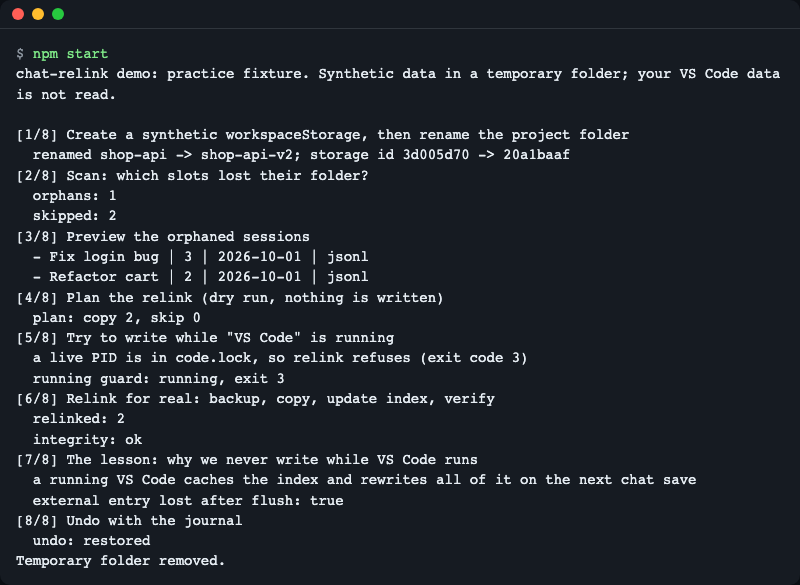
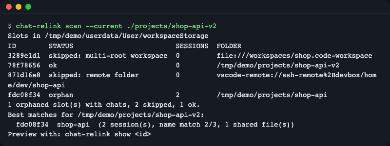
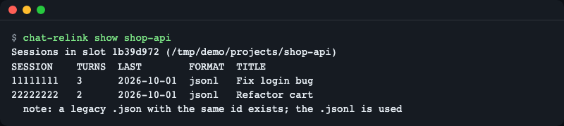
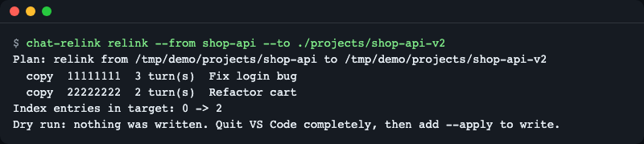
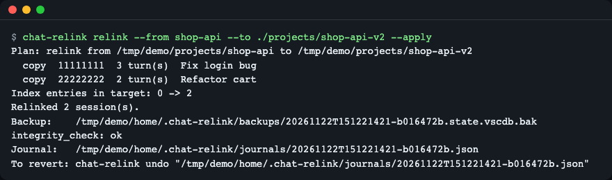
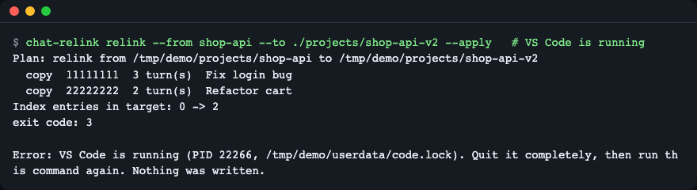
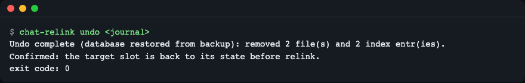
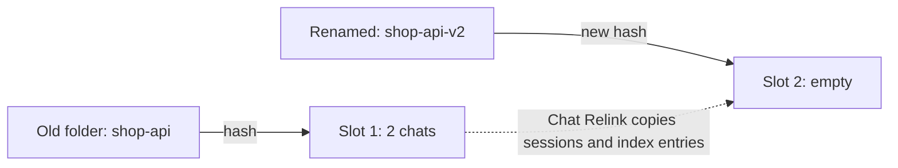

# Chat Relink

**English** | [한국어](README.ko.md)

Chat Relink finds the VS Code chat sessions that vanished after you renamed, moved or re-cloned a project folder, lets you preview them, and relinks them to the new folder with a backup, a verification step and an undo. It ships as a small read-only VS Code extension plus a Node CLI that share one TypeScript core with zero runtime dependencies.


*`npm start` runs the whole flow on a synthetic practice fixture. Your own VS Code data is not read.*

> **Honest status (v0.1.3).** All tests run against synthetic data and a mocked `vscode` API. The extension has **not** been run inside a real VS Code, and the CLI has only been run on macOS. See [Supported layouts & limits](#supported-layouts--limits) before pointing it at data you care about. The CLI never changes anything without `--apply`, and it backs up first.

## What it does

- **Finds orphaned chats.** It reads each `workspaceStorage/<id>/workspace.json`, and reports the slots whose folder no longer exists.
- **Previews them.** Title, number of turns, last date and file format per session, before you move anything.
- **Relinks them safely (CLI).** Dry run by default. With `--apply` it backs up the state database, copies the session files without overwriting, adds the index entries in one transaction, verifies the result and rolls back on failure. `undo` reverts it.
- **Opens them from inside VS Code (extension).** A notification offers the orphaned chats; you pick sessions in a QuickPick and open them through the official `Chat: Import Chat...` command. It never writes to VS Code's storage.

Think of it as a mail-forwarding service. You moved house and the post office still delivers to the old mailbox number. The letters (your chats) are not lost; they sit at the old address. Chat Relink looks for letters at old addresses and forwards them to the new one.

## Requirements

| Item | Version I checked | Note |
|---|---|---|
| Node.js | 26.13.0 (needs `>=22.13`) | The CLI uses the built-in `node:sqlite`, so there is nothing else to install |
| npm | 11.20.0 | |
| OS | macOS (CLI run) | Windows and Linux id rules are unit-tested with fixed values only |
| VS Code | not run | `engines.vscode` is `^1.146.0`; the extension was only tested against a mock |

Install Node.js with your package manager, for example `brew install node` on macOS or `sudo apt-get install nodejs npm` on Debian/Ubuntu (check that `node --version` is 22.13 or newer).

## Install

```bash
git clone https://github.com/LeeGyeongPil/chat-relink.git
cd chat-relink
npm ci
npm run build
```

Below, `chat-relink` means `node dist/cli/index.js`. To get a real `chat-relink` command, run `npm link` once.

To try the extension, build a VSIX and install it (this step was packaged but **not** installed into a real VS Code):

```bash
npm run package   # release step: downloads @vscode/vsce@4.1.1 with npx, needs network
code --install-extension chat-relink-0.1.3.vsix
```

## Quick start

Run the practice demo. It builds a synthetic `workspaceStorage` in a temporary folder, renames the project, and walks through every step on real files and a real SQLite database. You can run it without touching your own data.

```bash
npm start
```

The last lines look like this (English output, from a real run):

```text
[6/8] Relink for real: backup, copy, update index, verify
  relinked: 2
  integrity: ok
[7/8] The lesson: why we never write while VS Code runs
  a running VS Code caches the index and rewrites all of it on the next chat save
  external entry lost after flush: true
[8/8] Undo with the journal
  undo: restored
```

Then try it on your own data, with VS Code **closed** for the permanent step:

```bash
chat-relink scan --current ~/code/shop-api-v2
chat-relink show shop-api
chat-relink relink --from shop-api --to ~/code/shop-api-v2          # dry run
chat-relink relink --from shop-api --to ~/code/shop-api-v2 --apply  # writes
```

## Usage

The screenshots use the synthetic fixture from the demo: the folder `shop-api` was renamed to `shop-api-v2`.

### 1. Find orphans: `scan`


*Each row is one `workspaceStorage` slot. `orphan` means its folder is gone and it still holds chats. Remote and multi-root workspaces are skipped with a reason.*

`--current <folder>` ranks the orphans by how well they match that folder (name match, plus files that exist in both folders).

### 2. Preview: `show`


*Check titles, turns and dates before copying. A legacy `.json` file with the same id as a `.jsonl` is noted, and the `.jsonl` is used.*

### 3. Plan: `relink` without `--apply`


*The dry run lists what would be copied and how many index entries the target would have. Nothing is written.*

### 4. Apply: `relink --apply`


*A backup (`VACUUM INTO`) and a journal are written first. After the copy and the index update, the tool checks `PRAGMA integrity_check`, re-parses the index and confirms the files exist. A failed check rolls everything back (exit code 4).*

### 5. Refusing to write while VS Code runs


*If `code.lock` holds a live process id, the CLI stops with exit code 3 and writes nothing.*

### 6. Undo: `undo <journal>`


*The journal path was printed by `--apply`. Undo restores the database, or, if VS Code saved new chats in between, removes only the entries it added.*

### In VS Code

On startup the extension scans `workspaceStorage` in the background. If the folder you opened has no chats but a similar orphaned folder does, it shows a notification with **Review**, **Not now** and **Never for this folder**. You can also run **Chat Relink: Find Orphaned Chats** from the Command Palette.

- Pick sessions in the QuickPick (title, turns, last date) and they open one by one through `workbench.action.chat.import`. These are **imported copies**: VS Code's import drops the original session id and dates, so a copy may get a new id and date.
- **Relink permanently...** writes a plan file and copies the CLI command to your clipboard. Quit VS Code completely and paste it into a terminal. Only that path keeps the original session id, title and date.
- The copied command starts with `npx chat-relink relink ...`, so `npx` downloads the published `chat-relink` package from npm once (one network request, and the published version, not your clone). If you built from a clone, paste it with `node dist/cli/index.js` in place of `npx chat-relink`. If the package is not on npm yet, `npx` fails with a 404; use the `node dist/cli/index.js` form.

I could not capture screenshots of the extension because no real VS Code was available in my environment, so there are none here.

### Other commands

| Command | What it does |
|---|---|
| `chat-relink export --from <slot\|path> --out <dir>` | Writes one JSON per session for the official `Chat: Import Chat...`. Exported files can contain secrets that were pasted into chats, so treat them like the chats themselves. |
| `chat-relink demo [--keep]` | The practice demo. `--keep` leaves the synthetic folder so you can try the other commands on it. |
| `chat-relink --version` / `--help` | Prints `0.1.3` / the usage. |

Exit codes: 0 ok, 1 failure, 2 usage, 3 VS Code is running, 4 verification failed (rolled back), 5 target slot not found.

Common options: `--user-data-dir <dir>`, `--product code|insiders|vscodium|cursor`, `--json`, `--lang en|ko`.

## Configuration

| Key | Default | Description |
|---|---|---|
| `chatRelink.language` | `auto` | Extension language: `auto` (VS Code display language), `en`, `ko` |
| `chatRelink.scanOnStartup` | `true` | Look for orphaned chats when a folder is opened |
| `CHAT_RELINK_LANG` (env) | unset | CLI language `en` or `ko`. Priority: `--lang` > `CHAT_RELINK_LANG` > `LC_ALL`/`LC_MESSAGES`/`LANG` (starts with `ko` gives Korean) > English |
| `CHAT_RELINK_USER_DATA_DIR` (env) | unset | User data folder when `--user-data-dir` is not given |
| `CHAT_RELINK_HOME` (env) | `~/.chat-relink` | Where backups, journals and plans are written |

Default user data folders: `~/Library/Application Support/Code` (macOS), `%APPDATA%\Code` (Windows), `~/.config/Code` (Linux); `Code - Insiders`, `VSCodium` and `Cursor` via `--product`. Backups and journals go to `~/.chat-relink/backups` and `~/.chat-relink/journals` (change the base folder with `CHAT_RELINK_HOME`).

To try the other commands on the practice data, run `chat-relink demo --keep`. It prints `Kept the practice folder: <dir>`; then use `--user-data-dir <dir>/userdata` (for example `chat-relink scan --user-data-dir <dir>/userdata`) and set `CHAT_RELINK_HOME=<dir>/tool-home` so nothing is written to your real home folder.

## Why chats disappear

Each opened folder gets a storage slot named by a hash of the folder (path plus its creation time or inode). Rename, move or re-clone the folder and the hash changes, so VS Code looks in a new, empty slot. The old slot is still on disk.



## How it works

1. A slot is `workspaceStorage/<id>/` with a `workspace.json` (which folder), a `chatSessions/` folder (one `.jsonl` or legacy `.json` per session) and an index inside the shared `state.vscdb` SQLite file (key `chat.ChatSessionStore.index`).
2. The scanner finds slots whose folder does not exist, replays each session log for the preview and ranks candidates.
3. The relinker copies the files without overwriting and adds the index entries, with a backup, a journal and verification.
4. Tests inject the platform, file stat, PID liveness, home folder and locale instead of reading the real ones, so they behave the same on any OS.

## Safety design

Before anything is written, the CLI makes a backup of the state database and a journal. Files are copied without overwriting, the index is updated in one transaction, the result is verified, and a failed check rolls back. `undo` reverts a finished relink.

**Why it never writes while VS Code runs.** A running VS Code keeps the index in memory and rewrites all of it on its next chat save, which erases an outside edit. SQLite locking does not prevent this. `npm test` reproduces it with two real SQLite connections, and the demo shows it as `external entry lost after flush: true`. So the CLI refuses to write if `code.lock` holds a live PID, and the extension never writes at all.

**Access scope.** Everything is local. The tool makes no network requests. The CLI reads and (with `--apply`) writes the VS Code user data folder and `~/.chat-relink/`. The extension only reads `workspaceStorage`, plus a plan file under `~/.chat-relink/plans/`.

## Language

The CLI and the extension speak English and Korean. CLI: `--lang en|ko`, then `CHAT_RELINK_LANG`, then `LC_ALL`/`LC_MESSAGES`/`LANG`; anything not Korean gives English. Extension: the `chatRelink.language` setting (`auto` follows the VS Code display language).

## Supported layouts & limits

- The extension was tested only against a mocked `vscode` API. I have not confirmed in a real VS Code that an imported copy is saved to history or keeps its title.
- The Node 22.13 floor was checked locally only, not in CI.
- The workspace id rules for Windows and Linux are covered by unit tests with fixed values, not by runs on those systems. The macOS CLI run used the synthetic fixture, not a real VS Code profile.
- That `code.lock` contains a PID is taken from reading the VS Code source, not from a real installation.
- Remote, multi-root and empty-window slots are reported as `skipped`, not relinked.
- The session format and index key can change between VS Code versions. The tool refuses to write if the index `version` is not 1, and warns on unknown fields.
- VS Code keeps at most 400 chat index entries per slot (`maxPersistedSessions`); relink warns when the target would exceed it.

## When to use it

- Good fit: you renamed, moved or re-cloned a local folder and want its VS Code chats back, with a preview first and a backup.
- Other tools: for browsing chat history only, see the history viewers on the Visual Studio Marketplace. To follow the upstream discussions, see [microsoft/vscode#305818](https://github.com/microsoft/vscode/issues/305818) and [#257143](https://github.com/microsoft/vscode/issues/257143). For the official history sync, see the [VS Code session history docs](https://code.visualstudio.com/docs/agents/run/sessions/session-history).

## Troubleshooting

| Symptom | Cause | Fix |
|---|---|---|
| `Error: VS Code is running ... Nothing was written.` (exit 3) | `code.lock` holds a live PID | Quit VS Code completely (all windows), then run again |
| `No slot found for the folder ...` (exit 5) | The new folder was never opened, or the path differs from `workspace.json` | Open it in VS Code once, quit VS Code, run again |
| Exit code 4 | A verification check failed | The tool rolled back. Nothing changed; open an issue with the message |
| The node version message at start | Node is older than 22.13 | Install Node 22.13 or newer |
| Chats appear but have a new date | They were opened through the official import | Use the CLI relink to keep the original id, title and date |

## Development

```bash
npm ci
npm run typecheck
npm test          # about a second, offline
npm run build
npm start         # build, then the practice demo
```

CI is one Ubuntu 24.04 job on Node 24: `npm ci`, `npm run typecheck`, `npm test` (all offline). Node 22.13, the engines floor, was checked locally only. Changes are listed in [CHANGELOG.md](CHANGELOG.md).

## License

MIT.
